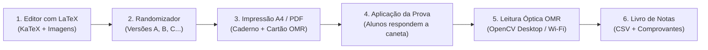

<div align="center">

# GabariTeX

### Elaborador de Provas com LaTeX, Embaralhador Anti-Cola e Corretor Óptico Automatizado (OMR)

[](https://github.com/Eduardo-Furlan/GabariTeX/releases/latest)
[](LICENSE.md)
[](https://github.com/Eduardo-Furlan/GabariTeX/releases/latest)
[](https://github.com/Eduardo-Furlan/GabariTeX)

<br />

[**Acessar Versão Web (GitHub Pages)**](https://eduardo-furlan.github.io/GabariTeX/) • [**Baixar Aplicativo Desktop**](https://github.com/Eduardo-Furlan/GabariTeX/releases/latest) • [**Reportar Problema**](https://github.com/Eduardo-Furlan/GabariTeX/issues)

<br />

</div>

> **Produto Pedagógico Universitário** desenvolvido integralmente com auxílio do **Google Antigravity**.

---

## Visão Geral

O **GabariTeX** é uma solução completa para elaboração, impressão e correção automatizada de avaliações acadêmicas, projetada especialmente para o contexto universitário e do ensino superior.

O sistema integra:
1. **Elaboração Rica com LaTeX**: Renderização nativa de equações matemáticas, fórmulas químicas e matrizes com KaTeX em tempo real.
2. **Embaralhamento Combinatório Anti-Cola**: Randomização determinística de questões e alternativas para $N$ versões da mesma prova.
3. **Diagramação A4 Rigorosa**: Geração de cadernos de questões em 1 ou 2 colunas com paginação discreta e cartões-resposta de leitura óptica padronizados.
4. **Segurança Criptográfica no Papel**: Gabarito oficial cifrado com **AES-256-GCM** dentro do QR Code impresso na folha, derivado da senha mestra do professor via PBKDF2 (SHA-256 com 100.000 iterações).
5. **Correção Óptica Automatizada (OMR)**: Leitura em tempo real e em lote acelerada por **OpenCV e Rust**, permitindo utilizar a webcam ou a **câmera do smartphone via Wi-Fi local sem instalar aplicativos**.
6. **Gestão de Notas e Comprovantes**: Diário de notas com estatísticas por questão, exportação em CSV/Excel e gerador de comprovantes impressos individualizados para os alunos.

---

## Links Rápidos

| Canal | Acesso | Descrição |
| :--- | :--- | :--- |
| **Aplicação Web** | [eduardo-furlan.github.io/GabariTeX](https://eduardo-furlan.github.io/GabariTeX/) | Elaboração de provas, randomização, gestão de turmas e impressão A4 diretamente no navegador (PWA offline). |
| **Última Release** | [GitHub Releases (v0.3.0)](https://github.com/Eduardo-Furlan/GabariTeX/releases/latest) | Instaladores e executáveis nativos desktop para **Linux** (`.deb`, `.AppImage`, `.rpm`) e **Windows** (`.exe`, `.msi`). |
| **Corretor OMR** | [Página do Corretor](https://eduardo-furlan.github.io/GabariTeX/#/corretor) | Detalhes e instruções do corretor óptico com OpenCV nativo e câmera sem fio. |

---

## Fluxo de Trabalho



---

## Funcionalidades Detalhadas

### 1. Editor de Avaliações com LaTeX em Tempo Real
- Tipografia matemática rigorosa via KaTeX: equações inline (`$E = mc^2$`) e blocos destacados (`$$\int_{a}^{b} f(x)\,dx$$`).
- Questões de múltipla escolha (2 a 5 alternativas) com indicação imediata do gabarito oficial.
- Questões dissertativas com controle de pauta de resposta (linhas pontilhadas dimensionáveis).
- Upload e embutimento de figuras e diagramas em Base64, preservando independência total de servidores externos.
- Importação rápida de questões entre provas da mesma biblioteca ou arquivo de perfil.

### 2. Randomizador Anti-Cola Determinístico
- Embaralhamento pseudo-aleatório através do algoritmo **Mulberry32**, garantindo reprodutibilidade das versões via semente (*seed*).
- Geração instantânea de chaves de resposta mapeadas automaticamente para cada versão (Versões A, B, C, D...).
- Eliminação total da cola em salas de aula sem necessidade de redigir diferentes provas manualmente.

### 3. Diagramação A4 Estrita e Cartão-Resposta Padronizado
- **Caderno de Questões com Paginação Discreta**: Cada folha de prova respeita a geometria física A4 (`210mm × 297mm`). O sistema mede dinamicamente o volume de cada questão, impedindo que enunciados ou fórmulas sejam partidos entre páginas.
- **Modo Duas Colunas**: Suporte a layout em duas colunas com divisória central contínua.
- **Rodapé Sempre na Base**: Linha horizontal de encerramento e identificação de folha (`Folha 1 de N`) fixadas rigorosamente no final da página A4.
- **Marcadores Fiduciais OMR**: 4 padrões de alinhamento de alto contraste nos vértices da folha para homografia e correção geométrica de perspectiva.

### 4. Criptografia AES-256-GCM no Papel
- O gabarito oficial não reside em bancos de dados em nuvem. Ele viaja cifrado dentro do próprio QR Code impresso no cabeçalho do cartão-resposta.
- Se um estudante escanear o QR Code da prova com a câmera do celular, verá apenas uma cadeia ininteligível de bytes (`MCORR:v1:...`).
- Na hora da correção, basta digitar a senha mestra da avaliação no GabariTeX Desktop para que a decodificação ocorra instantaneamente em memória.

### 5. Corretor Óptico Automatizado (GabariTeX Desktop)
- Processamento óptico nativo acelerado por **Rust + OpenCV**, permitindo leitura sub-milimétrica mesmo com variações de ângulo, perspectiva ou iluminação.
- **Câmera do Celular como Scanner Sem Fio**: Conecte qualquer smartphone conectado à mesma rede Wi-Fi escaneando um QR Code gerado pelo GabariTeX Desktop. Fotografe os gabaritos no celular e veja a correção ser computada no computador em tempo real, sem instalar nenhum aplicativo móvel.
- **Correção em Lote**: Fotografe dezenas de folhas sequencialmente com validação e salvamento automático.
- Espelho de prova interativo com visualização das bolinhas preenchidas, marcações duplas, em branco e detecção de rasuras.

### 6. Turmas, Livro de Notas e Comprovantes de Desempenho
- Gestão completa de turmas e matrículas de alunos.
- Associação automática da folha corrigida ao aluno cadastrado pela leitura de matrícula ou assinatura.
- Exportação dos resultados em formato tabular CSV (compatível com Excel, Google Planilhas e sistemas acadêmicos).
- **Gerador de Comprovantes**: Impressão de comprovantes individuais de nota (slips) para recortar e entregar aos estudantes.

---

## Tecnologias Utilizadas

| Camada | Tecnologia | Propósito |
| :--- | :--- | :--- |
| **Interface & SPA** | React 18, TypeScript, Tailwind CSS | Interface reativa, acessível e otimizada para Desktop e Mobile. |
| **Renderização Matemática** | KaTeX | Renderização ultrarrápida de fórmulas LaTeX offline. |
| **Criptografia** | Web Crypto API / Ring (Rust) | Cifra simétrica AES-256-GCM com derivação de chave PBKDF2 (SHA-256). |
| **Desktop Runtime** | Tauri v2 (Rust) | Executável leve, veloz e com baixo consumo de memória RAM. |
| **Visão Computacional** | OpenCV (C++ / Rust Bindings) | Detecção de contornos, homografia de perspectiva e amostragem óptica OMR. |
| **Câmera Remota** | Axum (HTTP / WebSocket) | Servidor local sem fio para pareamento de câmera móvel. |
| **Persistência Offline** | IndexedDB & SQLite (Tauri Plugin FS) | Armazenamento local com backup exportável em formato `.zip`. |
| **Qualidade & Testes** | Vitest (223+ testes unitários) | Cobertura rigorosa de criptografia, randomização, OMR e geometria de impressão. |

---

## Como Executar Localmente

### Pré-requisitos
- [Node.js](https://nodejs.org/) (v18 ou superior)
- [Rust & Cargo](https://rustup.rs/) (apenas para compilar a versão desktop nativa)
- Dependências de sistema para o Tauri (consulte o [Guia Oficial do Tauri v2](https://v2.tauri.app/start/prerequisites/))

### Passos para Desenvolvimento Web

```bash
# 1. Clonar o repositório
git clone https://github.com/Eduardo-Furlan/GabariTeX.git
cd GabariTeX

# 2. Instalar as dependências do projeto
npm install

# 3. Iniciar o servidor de desenvolvimento Vite
npm run dev

# 4. Executar a suíte de testes unitários
npm test

# 5. Gerar build estático otimizado
npm run build
```

### Passos para Desenvolvimento Desktop (Tauri)

```bash
# Executa a aplicação nativa conectada ao frontend Vite com hot-reload
npm run tauri dev

# Compila os pacotes e instaladores de produção (.deb, .AppImage, .exe, etc.)
npm run tauri build
```

---

## Privacidade e Segurança

- **100% Client-Side / Local**: Nenhuma foto de prova, dado de estudante ou gabarito é transmitido para servidores de terceiros ou nuvem.
- **Funcionamento Offline**: O sistema funciona perfeitamente sem conexão à internet após o primeiro carregamento ou na versão desktop nativa.
- **Custo Zero de Infraestrutura**: Não requer hospedagem paga, banco de dados gerenciado ou APIs pagas de IA.

---

## Licença

Este projeto é software livre sob a licença [GNU General Public License v3.0 (GPL-3.0)](LICENSE.md).

A licença aplica-se ao código-fonte desenvolvido neste repositório. As dependências e bibliotecas externas de terceiros (como React, KaTeX, Tailwind CSS, OpenCV, Tauri, Lucide, etc.) permanecem regidas por suas respectivas licenças individuais.
